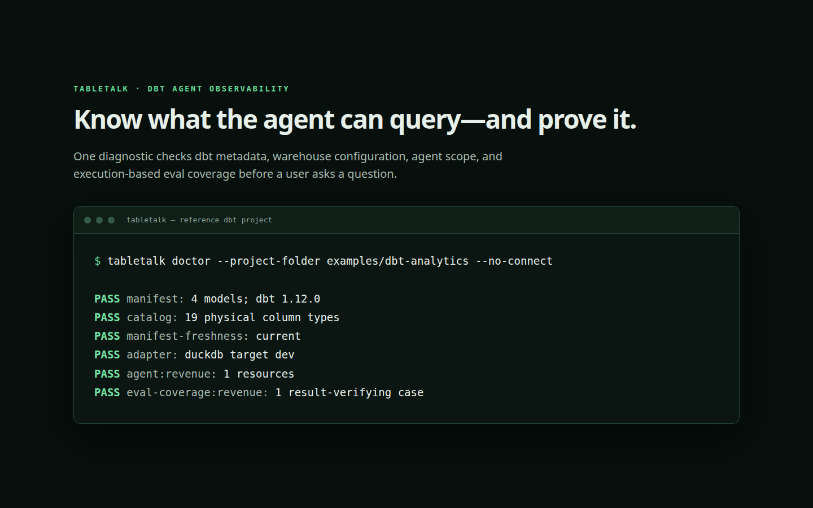

# TableTalk

**Evaluation and observability for natural-language data agents built on dbt.**

[](https://github.com/wtbates99/tabletalk/actions/workflows/db_provider_tests.yml)
[](https://www.python.org/)
[](https://pypi.org/project/tabletalk/)
[](LICENSE)



TableTalk turns an existing dbt project into a controlled natural-language
interface. The dbt manifest defines what an agent may query; TableTalk adds
read-only execution, scope enforcement, execution-based evals, and a receipt
showing how every answer was produced.

## Why TableTalk

Most text-to-SQL demos stop when a model emits plausible SQL. TableTalk checks
the work:

- **dbt-native scope** — select models by group, tag, path, package, source, or lineage.
- **Read-only enforcement** — reject unknown relations, unknown columns, unsafe statements, and unbounded results before execution.
- **Execution-based evals** — compare real query results, shape, counts, tolerances, and evidence rather than grading prose.
- **Answer provenance** — retain SQL, dbt nodes, columns, test health, assumptions, model identity, latency, and token usage.
- **Honest verification** — exact approved questions can be `VERIFIED`; everything else is visibly `UNVERIFIED`.

## Install

```bash
pip install tabletalk
pip install "tabletalk[duckdb]"     # optional DuckDB adapter
pip install "tabletalk[snowflake]"  # optional Snowflake adapter
```

Requires Python 3.10 or newer. SQLite support uses Python's standard library.

## Start from a dbt project

```console
cd my-dbt-project
dbt parse
dbt docs generate  # recommended: adds physical warehouse types

tabletalk init
tabletalk agent create
tabletalk eval create revenue
tabletalk eval run revenue
tabletalk ask revenue "What was recognized revenue last month?"
```

`tabletalk init` locates `dbt_project.yml` and `target/manifest.json`, resolves
a supported SQLite, DuckDB, or Snowflake target, and writes only non-secret
settings. Agent creation previews the exact dbt resources before writing a
small selector-based definition:

```yaml
name: revenue
description: Answers questions about recognized revenue.
select:
  - group:finance
  - tag:revenue
exclude:
  - model:customer_sensitive
instructions:
  - Use recognized revenue unless the user explicitly requests bookings.
sample_questions:
  - What was recognized revenue last month?
```

Descriptions, columns, tests, constraints, ownership, access, tags, and
lineage remain authoritative in dbt rather than being copied into agent files.

## Correctness and provenance

Live questions and eval cases call the same runtime. Before execution,
TableTalk requires one read-only query, in-scope manifest relations, known
columns, explicit join conditions, row and timeout limits, and explicit
sensitive-data permission.

Every result can include:

- answer, interpretation, and assumptions;
- generated and executed SQL;
- dbt nodes, columns, lineage, and relevant test health;
- bounded evidence and evidence-linked claims;
- manifest, agent, model, and warehouse identity;
- verification outcomes, latency, and token usage.

See the [reference dbt project](examples/dbt-analytics/README.md) and
[getting-started guide](docs/getting-started.md) for a deterministic local
walkthrough.

## Commands

```text
tabletalk init
tabletalk agent create|list|show
tabletalk eval create|run
tabletalk ask
tabletalk doctor
```

Run `tabletalk COMMAND --help` for the complete interface.

## Security model

- Use a database identity that is independently restricted to read-only access.
- SQL validation is an additional boundary, not a replacement for warehouse permissions.
- Credentials are not written into generated agent definitions or run receipts.
- Model, database, and empty-evidence failures are reported; they are not replaced with invented answers.

## Development

```bash
uv sync --locked --all-groups
uv run pytest -q
uv run ruff check tabletalk
uv run mypy tabletalk
uv build
```

## License

TableTalk is **source available** under the
[PolyForm Noncommercial License 1.0.0](LICENSE). Personal and noncommercial
use is permitted under those terms. Commercial use requires a
[separate license](COMMERCIAL-LICENSE.md).

Earlier releases remain governed by the terms under which they were
published; see [license history](LICENSE_HISTORY.md).
